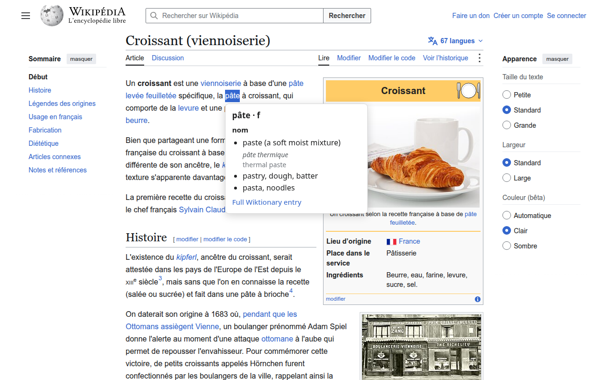

# Word Lookup

Word Lookup is a small browser extension that shows English Wiktionary
definitions for a selected word. It supports English, French, Spanish, German,
Italian, Dutch, Swedish, and Romanian words.

## Get the extension

- [Chrome Web Store](https://chromewebstore.google.com/detail/word-lookup/fmkaeiligcgpdmmblhkjangciejijpco)
- [Firefox Add-ons](https://addons.mozilla.org/en-US/firefox/addon/word_lookup/)
- [Project page](https://lasu.dev/word-lookup/)



The screenshots in `screenshots/` show live lookups on Wikipedia in French,
German, Spanish, Italian, and Swedish. They are 1280×800 PNGs for the store
listings. To regenerate them with Chromium and the unpacked extension:

```sh
node screenshots/capture.mjs "$PWD" "$PWD/screenshots" [french,german,...]
```

## How it works

1. Select one complete word on a web page.
2. The content script sends the word and selected word language to the
   extension's background script.
3. The background script requests the word's entry from English Wiktionary.
4. The extension extracts definitions, parts of speech, example sentences, and
   links to related headwords, then displays them beside the selection. For an
   ambiguous form, it looks up the first headword; **Show all forms** fetches the
   remaining headwords only when requested.
5. When noun gender is enabled for a supported language, the background script
   also asks Apertium for morphological analysis.

Lookups, examples, noun genders, the loading indicator, and “no entry found”
messages can be configured from the Settings tab in the extension popup. The
History tab keeps the 100 most recently looked-up headword/language pairs
locally, deduplicated and shown with links to Wiktionary. Inflected forms are
recorded under the headword that was displayed. You can clear the list at once.
Older history entries are reduced to this format on the next lookup. Gender
enrichment is display-only and does not write a second history entry.
Preferences and history are stored locally by the browser; failed or unavailable
lookups are not recorded.

## APIs

- **English Wiktionary REST API**
  (`https://en.wiktionary.org/api/rest_v1/page/definition/`) provides
  definitions, parts of speech, examples, and inflection information.
  English Wiktionary contains entries for words from all supported languages.

- **Apertium APY** (`https://www.apertium.org/apy/analyze`) provides
  morphological analysis used only to identify noun gender. No request
  is made to Apertium when noun genders are disabled or the selected language is
  unsupported by the analyzer.

Selected words are sent to these services as needed. The extension does not run
a server. It locally stores its enabled and display preferences, the selected
word language (under the existing `sourceLanguage` storage key for migration
compatibility), and up to 100 successful lookup history records containing only
the headword and its language. History mutations are serialized by the
background service worker, and failed lookups are not added.

Definitions and examples come from English Wiktionary contributors. Wiktionary
text is available under [CC BY-SA 4.0](https://creativecommons.org/licenses/by-sa/4.0/)
and, unless otherwise noted, the GFDL. Noun analysis is provided by
[Apertium](https://www.apertium.org/). This extension is not endorsed by or
affiliated with the Wikimedia Foundation.

## Install locally

### Chromium, Chrome, or Edge

1. Open `chrome://extensions` or `edge://extensions`.
2. Enable **Developer mode**.
3. Choose **Load unpacked** and select this directory.

### Firefox 140+

1. Run `./build.sh`.
2. Extract `dist/word-lookup-<version>-firefox.zip`.
3. Open `about:debugging#/runtime/this-firefox`.
4. Choose **Load Temporary Add-on** and select the extracted `manifest.json`.

## Build

Run:

```sh
./build.sh
```

This creates separate Chromium and Firefox ZIP files in `dist/`. The extension
itself is plain HTML, CSS, and JavaScript. Building requires only standard shell
tools, Python 3, and `zip`; Node.js and npm are not required.

## Tests

npm is used only for development tests. It installs `linkedom`, which supplies a
small DOM implementation so the content and settings scripts can be tested in
Node.js.

```sh
npm install
npm test
```

To run syntax checks, tests, and package builds together:

```sh
npm run check
```
